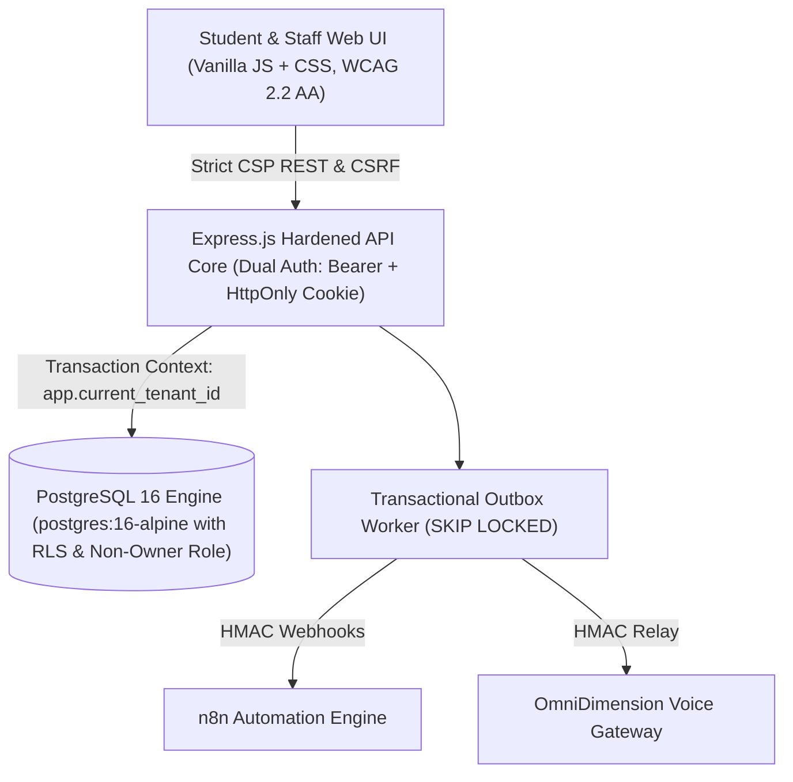

# CampusPilot AI 🎓
> **One campus interface. Connected departments. Accountable outcomes.**

> [!NOTE]
> **Fictional Sample Data Notice:** All institutional regulations, handbooks (`data/sample_fictional_handbook.md`), user accounts, and campus entities represent a fictional institution (*Oakwood Institute of Technology*). No real college, real student, or live vendor credentials are included.

CampusPilot AI is an enterprise-grade multi-tenant operations coordination, institutional knowledge engine, and service desk platform for higher education institutions. It unites students, departmental coordinators, hostel wardens, and campus leadership into a single accountable, human-in-the-loop operating system.

---

## 🌟 Key Capabilities & Differentiators

### 1. 🛡️ Strict Human Authority (Zero AI Auto-Approvals)
* **Outpass & Gate Clearances:** Automated voice agents verify guardian consent via staff-verified parent records, but final approval requires human hostel warden sign-off.
* **Campus Event Clearance:** 3-tier sequential review (Faculty Advisor ➔ Academic Dean ➔ Venue Administrator).

### 2. 📖 Grounded Multi-Tenant Knowledge Base (Stage 3)
* **Exact Section Citations (§X.Y):** Instant deterministic answers for campus curfew (§2.1), library loan policies (§1.2), and emergency SLAs (§3.1).
* **Zero Hallucination Fallback:** When a query is out-of-scope or unverified, the system explicitly declines and routes the student to the responsible department desk with verified contact details.
* **Fictional Demonstration Data Notice:** All institutional regulations and policies in the sample handbook (`data/sample_fictional_handbook.md`) represent a completely fictional institution (*Oakwood Institute of Technology*). No real college or live individual data is bundled.

### 3. 📱 Cryptographically Signed QR Outpasses & Gate Scanner (Stage 4)
* **HMAC-SHA256 Signed Gate Passes:** Warden approval generates an encrypted base64 payload.
* **Mobile Gate Scanner (`/gate-scan`):** Security personnel verify student exit and entry permissions with instant tamper detection and expiration enforcement.

### 4. 📊 Operations Analytics & Interactive ROI Calculator (Stage 4)
* Real-time metrics on SLA compliance %, average turnaround time, and FAQ deflections.
* Live adjustable ROI calculator estimating annual institutional savings based on student population and staff wages.

### 5. 🔒 DPDP 2023 Controls & Tamper-Evident Hash Chaining
* **Append-Only DB Triggers:** Database-level rules strictly prohibit updates or deletions from `audit_log` and `security_events`.
* **Data Rights:** Self-service student personal data export (JSON) and permanent PII erasure controls (legal review pending).

---

## 🏗️ Architecture Topology

CampusPilot is designed around a three-tier topology with total multi-tenant isolation:



For complete technical diagrams and sequence flows, see [docs/architecture.md](file:///Users/atoshi/Desktop/Campus-Pilot/docs/architecture.md).  
For the 16-table database schema and RLS policies, see [docs/database_erd.md](file:///Users/atoshi/Desktop/Campus-Pilot/docs/database_erd.md).  
For the RESTful API matrix, see [docs/api_specification.md](file:///Users/atoshi/Desktop/Campus-Pilot/docs/api_specification.md).  
For the compliance and security runbook, see [docs/security_and_privacy.md](file:///Users/atoshi/Desktop/Campus-Pilot/docs/security_and_privacy.md).

---

## ⚡ Quickstart & Local Development

### Prerequisites
* [Docker](https://www.docker.com/) & Docker Compose
* Node.js v20+ or [Bun](https://bun.sh/)
* PostgreSQL 16+ (or run via Docker Compose)

### 1. Launch All Services via Docker Compose
```bash
docker compose up -d --build
```
This boots:
* **PostgreSQL 16**: Port `5432` with automatic role and schema migrations.
* **CampusPilot Backend**: Port `3000` with production boot guards and healthcheck.
* **CampusPilot Frontend**: Port `8080` (Nginx Alpine with strict CSP headers).
* **n8n Workflow Engine**: Port `5678`.

### 2. Local Manual Development Setup
```bash
# 1. Install dependencies
cd backend && npm install
cd ../frontend && npm install

# 2. Run Database Migration & Roles Setup
node backend/scripts/migrate.js

# 3. Start Backend Server
npm --prefix backend run dev

# 4. Run Test Suite (79 Tests Green)
npm --prefix backend test
```

---

## 🔐 Environment Configuration (.env)

| Variable | Description | Production Default / Requirement |
| :--- | :--- | :--- |
| `NODE_ENV` | Runtime environment mode | `production` |
| `PORT` | API server port | `3000` |
| `POSTGRES_HOST` | Database host | `postgres` (or `localhost`) |
| `POSTGRES_PORT` | Database port | `5432` |
| `POSTGRES_DB` | Database name | `campuspilot` |
| `POSTGRES_USER` | Runtime app user (non-owner) | `campuspilot_app` |
| `POSTGRES_PASSWORD`| Runtime app password | Secure 32-char string |
| `REQUIRE_REAL_DB` | Enforce real PostgreSQL (no pg-mem) | `true` |
| `DEMO_MODE` | Allow development simulation routes | `false` in production |
| `JWT_SECRET` | 256-bit secret for session tokens | $\ge 32$ chars random string |
| `VOICE_HMAC_SECRET`| Secret for OmniDimension callbacks | $\ge 32$ chars random string |
| `OUTPASS_HMAC_SECRET`| Secret for QR gate pass signatures | $\ge 32$ chars random string |
| `CORS_ALLOWLIST` | Comma-separated allowed web origins | e.g. `https://campus.oakwood.edu` |

---

## 🧪 Comprehensive Verification Suite

CampusPilot includes 79 automated Vitest tests validating every security, concurrency, multi-tenant, and product capability:

```bash
bun run --cwd backend test
```
* **`test/stage0_foundation.test.js`** (10 tests): Real PostgreSQL 18.4 connection, non-owner role RLS, pooled connection isolation, refresh token grace windows.
* **`test/phase1_hardening.test.js`** (10 tests): SHA-256 hash chaining under 20 parallel writes, transactional outbox with SKIP LOCKED, SLA watchdog, cross-tenant leak checks.
* **`test/security.test.js`** (28 tests): 50 parallel concurrent submissions, CSRF protection, session family revocation, voice HMAC replay prevention, account lockout.
* **`test/stage3_knowledge_base.test.js`** (12 tests): Markdown chunking, versioned ingestion, exact §X.Y citations, out-of-domain honest fallback, RLS isolation.
* **`test/stage4_product.test.js`** (19 tests): Onboarding wizard, staff CSV bulk import, super-admin metrics, cryptographic QR gate scan, 3-tier event approvals, DPDP consent & account erasure.

---

## 📄 Production Deployment Checklist

1. [x] Real PostgreSQL with `campuspilot_app` non-owner user (no superuser access).
2. [x] Row-Level Security enabled on all 16 application tables.
3. [x] Strict Content Security Policy (`script-src 'self'`, `script-src-attr 'none'`).
4. [x] All demo data uses fictional Oakwood Institute dataset (no real PII).
5. [x] Production boot guard fails on `DEMO_MODE=true` or missing secrets.
6. [x] Dockerfile and Docker Compose with healthchecks configured.
