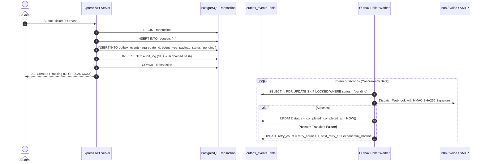
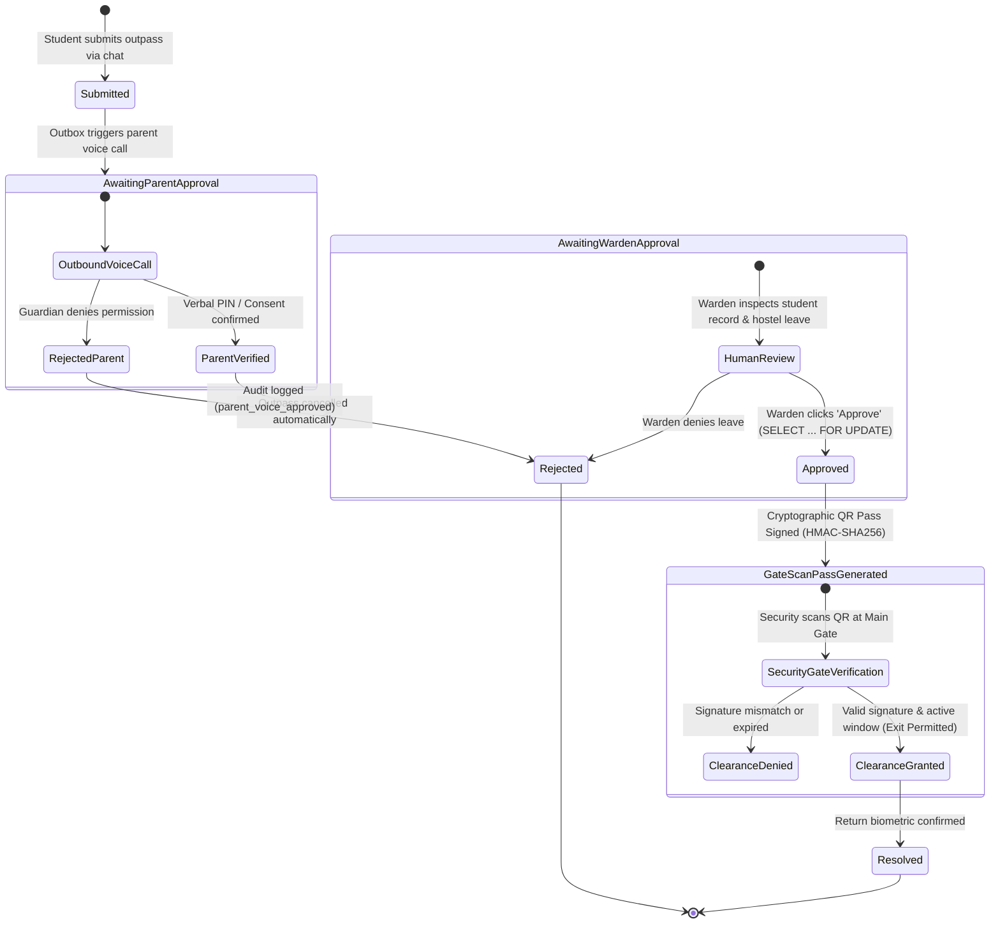

# CampusPilot AI — System Architecture & Engineering Specifications

## 1. Executive Summary & Design Principles

CampusPilot AI is an enterprise-grade multi-tenant campus operations and service desk platform designed for higher education institutions. It unites conversational student intake, automated workflow processing, and staff operational governance into a zero-trust, human-in-the-loop architecture.

### Core Non-Negotiables
1. **Strict Human Authority:** Automated agents and AI models *never* auto-approve disciplinary actions, gate passes, or campus leave. Final authority resides exclusively with human hostel wardens and faculty administrators.
2. **Zero PII Exposure & DPDP 2023 Readiness:** Student parent contacts are immutable records verified by college staff. Data exports, audit logs, and account sanitization mechanisms comply with Indian Digital Personal Data Protection (DPDP) Act 2023 principles.
3. **Multi-Tenant Row-Level Security (RLS):** Every database connection enforces transaction-local tenant context (`set_config('app.current_tenant_id', ..., true)`), guaranteeing zero data leakage across institutional boundaries even in pooled connection topologies.
4. **Tamper-Evident SHA-256 Audit Trails:** All state transitions and critical operational actions are recorded in an append-only cryptographic ledger with database-level `BEFORE UPDATE OR DELETE` block triggers.

---

## 2. Three-Tier Architectural Topology

```mermaid
graph TD
    subgraph Tier1["Tier 1: Student-Facing Experience"]
        WebUI["Mission Control Web UI (Vanilla JS + CSS)"]
        ChatEngine["Grounded Conversational Intake"]
        FaqRAG["Handbook Semantic Search (§X.Y Citations)"]
        GateScan["Security Gate Mobile Scanner (/gate-scan)"]
    end

    subgraph Tier2["Tier 2: Core Application & Orchestration Engine"]
        Express["Express.js Enterprise Core (Node.js 20)"]
        AuthModule["Dual Auth (JWT Bearer + HttpOnly Cookie + CSRF)"]
        OutboxWorker["Transactional Outbox Worker (SKIP LOCKED)"]
        SlaEngine["SLA Escalation Watchdog"]
        VoiceService["OmniDimension Voice Webhook Relay (HMAC-SHA256)"]
        AuditChainer["Tamper-Evident SHA-256 Chain Writer"]
        n8n["n8n Workflow Automation Engine"]
    end

    subgraph Tier3["Tier 3: Multi-Tenant Data & Cryptographic Layer"]
        Postgres[("PostgreSQL 18.4 Engine")]
        RLSPolicies["PostgreSQL Row-Level Security (RLS)"]
        AppendOnlyTriggers["Append-Only DB Triggers (Audit Log & Security Events)"]
        LocalVectors["Dense Semantic Embeddings (256-dim)"]
    end

    WebUI -->|REST / JSON + CSRF| Express
    ChatEngine --> FaqRAG
    Express --> AuthModule
    Express --> AuditChainer
    Express --> OutboxWorker
    Express --> SlaEngine
    Express --> VoiceService
    Express -->|set_config('app.current_tenant_id')| Postgres
    Postgres --- RLSPolicies
    Postgres --- AppendOnlyTriggers
    OutboxWorker -->|Reliable Events| n8n
```

---

## 3. Transactional Outbox Pattern & SKIP LOCKED Poller

To eliminate dual-write hazards between PostgreSQL state changes and external notification webhooks (n8n, OmniDimension, Brevo/SMTP), CampusPilot uses the **Transactional Outbox Pattern**:



---

## 4. Cryptographic Outpass Approval & Security Gate Workflow



---

## 5. Security & Threat Mitigation Summary

| Threat / Vulnerability Vector | Mitigation Mechanism | Verification Test |
| :--- | :--- | :--- |
| Cross-Tenant Data Leakage | PostgreSQL RLS on all 16 tables with non-owner role `campuspilot_app` | `test/phase1_hardening.test.js` |
| Refresh Token Theft / Replay | Token family rotation with immediate family revocation on replay | `test/security.test.js` |
| Webhook Replay Attack | `webhook_idempotency` table with primary key replay rejection | `test/security.test.js` |
| Outpass QR Forgery | HMAC-SHA256 signature combining tracking ID, student ID, and valid_until | `test/stage4_product.test.js` |
| Audit Trail Alteration | Append-only DB trigger: `RAISE EXCEPTION 'Audit log is append-only'` | `test/phase1_hardening.test.js` |
| Concurrent Ticket Number Collision | Atomic counter sequence updates with transaction locks | `test/security.test.js` (50 parallel) |
