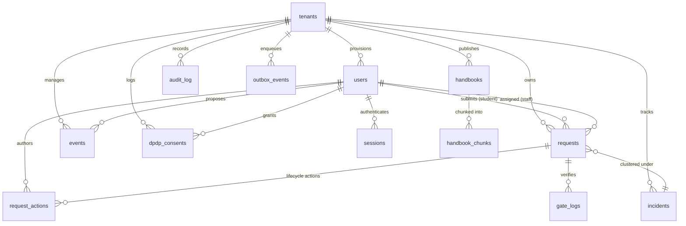

# CampusPilot AI — Database Schema & Entity-Relationship Specifications

## 1. Entity-Relationship Overview

CampusPilot AI runs on **PostgreSQL 18.4** enforcing native Row-Level Security (RLS) across all institutional data. All tenant-isolated tables reference `tenants(id)` and evaluate:
```sql
USING (tenant_id = NULLIF(current_setting('app.current_tenant_id', true), '')::uuid)
```



---

## 2. Table-by-Table Schema Matrix

### 0. `tenants`
Multi-tenancy root directory.
* `id` UUID PRIMARY KEY DEFAULT `uuid_generate_v4()`
* `name` VARCHAR(255) NOT NULL
* `slug` VARCHAR(100) UNIQUE NOT NULL
* `domain` VARCHAR(255) UNIQUE
* `plan` VARCHAR(50) DEFAULT `'campus_pro'`
* `max_students` INTEGER DEFAULT 5000
* `config` JSONB DEFAULT `'{}'` (branding, departments, SLA rules)
* `created_at` TIMESTAMP WITH TIME ZONE DEFAULT CURRENT_TIMESTAMP

### 1. `users`
Student directory and staff roster.
* `id` UUID PRIMARY KEY
* `tenant_id` UUID NOT NULL REFERENCES tenants(id)
* `name` VARCHAR(255) NOT NULL
* `email` VARCHAR(255) UNIQUE NOT NULL
* `password_hash` VARCHAR(255)
* `phone` VARCHAR(50)
* `role` VARCHAR(50) CHECK IN (`student`, `coordinator`, `admin`, `faculty`, `warden`, `security_gate`, `department_head`, `super_admin`)
* `department` VARCHAR(100)
* `roll_number` VARCHAR(50)
* `parent_name` VARCHAR(255)
* `parent_phone` VARCHAR(50) (staff-verified; student edits prohibited)
* `hostel_block` VARCHAR(100)
* `room_no` VARCHAR(50)
* `is_active` BOOLEAN DEFAULT TRUE
* `created_at` TIMESTAMP WITH TIME ZONE

### 2. `sessions`
Revocable session and refresh token family storage.
* `id` UUID PRIMARY KEY
* `tenant_id` UUID NOT NULL REFERENCES tenants(id)
* `user_id` UUID NOT NULL REFERENCES users(id) ON DELETE CASCADE
* `family_id` UUID DEFAULT `uuid_generate_v4()`
* `refresh_token_hash` VARCHAR(255) NOT NULL
* `user_agent` TEXT
* `ip_address` VARCHAR(45)
* `is_revoked` BOOLEAN DEFAULT FALSE
* `expires_at` TIMESTAMP WITH TIME ZONE NOT NULL

### 3. `incidents`
Clustered operational events uniting related tickets.
* `id` UUID PRIMARY KEY
* `tenant_id` UUID NOT NULL REFERENCES tenants(id)
* `incident_code` VARCHAR(50) UNIQUE NOT NULL (`INC-YYYY-XXXX`)
* `title` VARCHAR(255) NOT NULL
* `category` VARCHAR(100) NOT NULL
* `location` VARCHAR(255) NOT NULL
* `severity` VARCHAR(50) DEFAULT `'medium'`
* `status` VARCHAR(50) DEFAULT `'investigating'`
* `ticket_count` INTEGER DEFAULT 1

### 4. `requests`
Core tickets, complaints, event proposals, and outpasses.
* `id` UUID PRIMARY KEY
* `tenant_id` UUID NOT NULL REFERENCES tenants(id)
* `tracking_id` VARCHAR(50) UNIQUE NOT NULL (`CP-YYYY-XXXX`)
* `type` VARCHAR(50) CHECK IN (`complaint`, `suggestion`, `event_proposal`, `general_inquiry`, `outpass`)
* `category` VARCHAR(100) NOT NULL
* `location` VARCHAR(255)
* `title` VARCHAR(255) NOT NULL
* `description` TEXT NOT NULL
* `urgency` VARCHAR(50) DEFAULT `'medium'`
* `status` VARCHAR(50) CHECK IN (`submitted`, `triaged`, `awaiting_details`, `assigned`, `in_progress`, `awaiting_approval`, `awaiting_parent_approval`, `awaiting_warden_approval`, `approved`, `resolved`, `confirmed`, `escalated`, `reopened`, `rejected`)
* `student_id` UUID REFERENCES users(id)
* `student_name`, `student_email`, `student_phone`
* `parent_name`, `parent_phone`
* `outpass_code` VARCHAR(100)
* `outpass_valid_until` TIMESTAMP WITH TIME ZONE
* `outpass_signature` VARCHAR(255) (HMAC-SHA256 signature for QR)
* `voice_call_status` VARCHAR(50) CHECK IN (`none`, `pending`, `completed`, `failed_no_answer`, `skipped`, `failed_dispatch`)
* `sla_due_at` TIMESTAMP WITH TIME ZONE
* `escalation_level` INTEGER DEFAULT 0

### 5. `request_actions`
Immutable lifecycle audit trail on individual tickets.
* `id` UUID PRIMARY KEY
* `tenant_id` UUID NOT NULL REFERENCES tenants(id)
* `request_id` UUID NOT NULL REFERENCES requests(id) ON DELETE CASCADE
* `actor_type` VARCHAR(50) (session-derived)
* `actor_id` UUID REFERENCES users(id)
* `action_type` VARCHAR(100) NOT NULL
* `notes` TEXT
* `payload` JSONB DEFAULT `'{}'`

### 6. `notifications`
Notification log and email dispatch tracking.
* `id` UUID PRIMARY KEY
* `tenant_id` UUID NOT NULL REFERENCES tenants(id)
* `recipient_email` VARCHAR(255) NOT NULL
* `subject` VARCHAR(255) NOT NULL
* `html` TEXT NOT NULL
* `status` VARCHAR(50) DEFAULT `'pending'`

### 7. `tracking_counters`
Global atomic counters for sequential ID generation.
* `counter_type` VARCHAR(50) PRIMARY KEY (`requests`, `incidents`)
* `current_val` INTEGER NOT NULL

### 8. `webhook_idempotency`
Replay attack prevention ledger.
* `idempotency_key` VARCHAR(255) PRIMARY KEY
* `created_at` TIMESTAMP WITH TIME ZONE

### 9. `knowledge_base`
Structured FAQ entries.
* `id` UUID PRIMARY KEY
* `tenant_id` UUID NOT NULL REFERENCES tenants(id)
* `category`, `question`, `answer`, `keywords`, `source`

### 10. `security_events`
Security alerts and lockout records with append-only block trigger.
* `id` UUID PRIMARY KEY
* `tenant_id` UUID NOT NULL REFERENCES tenants(id)
* `event_type` VARCHAR(100) NOT NULL
* `severity` VARCHAR(50) DEFAULT `'warning'`
* `actor_email`, `ip_address`, `details`

### 11. `outbox_events`
Transactional outbox pattern queue.
* `id` UUID PRIMARY KEY
* `tenant_id` UUID NOT NULL REFERENCES tenants(id)
* `aggregate_type`, `aggregate_id`, `event_type`, `payload`
* `status` VARCHAR(50) DEFAULT `'pending'`
* `retry_count` INTEGER DEFAULT 0
* `max_retries` INTEGER DEFAULT 5
* `next_retry_at` TIMESTAMP WITH TIME ZONE

### 12. `audit_log`
Tamper-evident SHA-256 hash-chained immutable audit ledger.
* `id` UUID PRIMARY KEY
* `tenant_id` UUID NOT NULL REFERENCES tenants(id)
* `actor_id`, `actor_email`, `actor_role`, `action`, `resource_type`, `resource_id`
* `previous_state` JSONB
* `new_state` JSONB
* `previous_hash` VARCHAR(64) NOT NULL
* `current_hash` VARCHAR(64) NOT NULL
* `ip_address` VARCHAR(50)
* Trigger: `BEFORE UPDATE OR DELETE -> RAISE EXCEPTION 'audit_log is append-only'`

### 13. `handbooks` & `handbook_chunks`
Versioned institutional student handbook storage and 256-dim embeddings.
* `handbooks`: `id`, `tenant_id`, `title`, `filename`, `version`, `status`
* `handbook_chunks`: `id`, `tenant_id`, `handbook_id`, `section_title`, `section_citation`, `content`, `embedding` (JSONB/vector), `token_count`, `version`

### 14. `events`
Three-tier campus events approval chain.
* `id` UUID PRIMARY KEY
* `tenant_id` UUID NOT NULL REFERENCES tenants(id)
* `title`, `description`, `venue`, `event_date`, `estimated_attendees`, `budget`
* `status` CHECK IN (`pending_faculty`, `pending_dean`, `pending_venue`, `approved`, `rejected`)
* `approvals` JSONB DEFAULT `'[]'`

### 15. `dpdp_consents`
Digital Personal Data Protection (DPDP) Act 2023 consent records.
* `id` UUID PRIMARY KEY
* `tenant_id` UUID NOT NULL REFERENCES tenants(id)
* `user_id` UUID NOT NULL REFERENCES users(id)
* `consent_type`, `purpose`, `granted`, `ip_address`, `timestamp`

### 16. `gate_logs`
Security gate scanner log for cryptographic pass verification.
* `id` UUID PRIMARY KEY
* `tenant_id` UUID NOT NULL REFERENCES tenants(id)
* `request_id`, `student_id`, `outpass_code`, `gate_location`, `direction`, `verified_by`, `verified_at`
